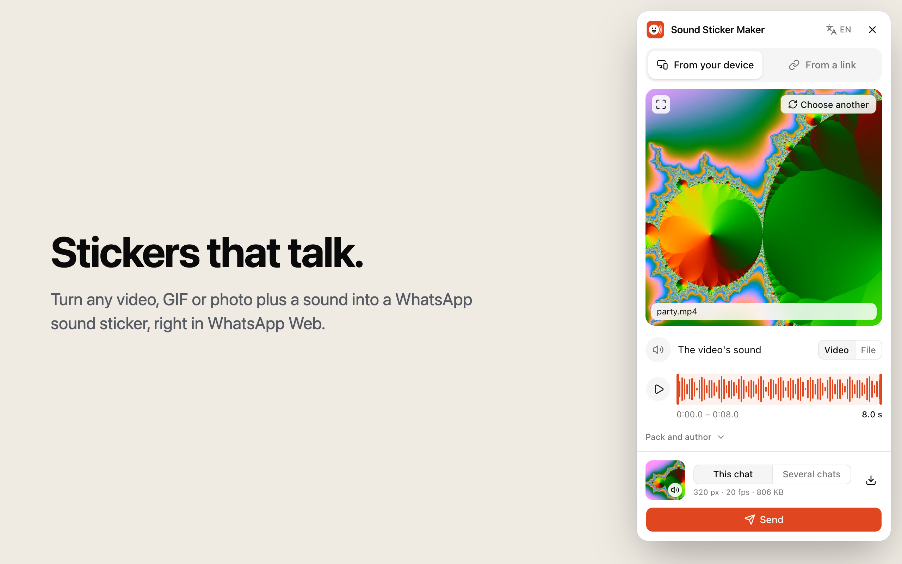
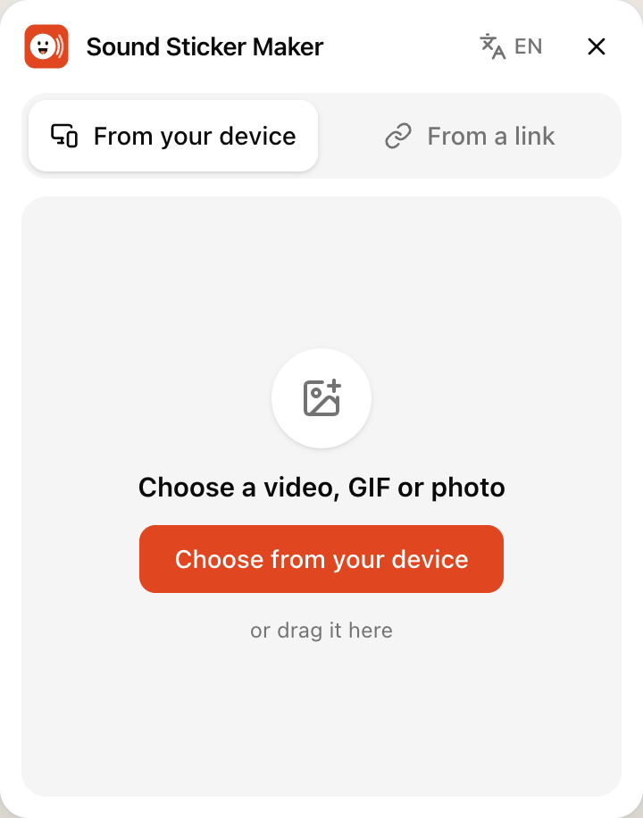
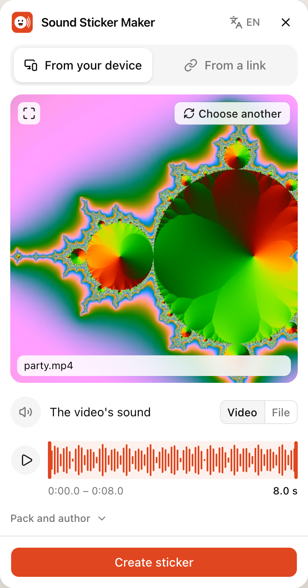
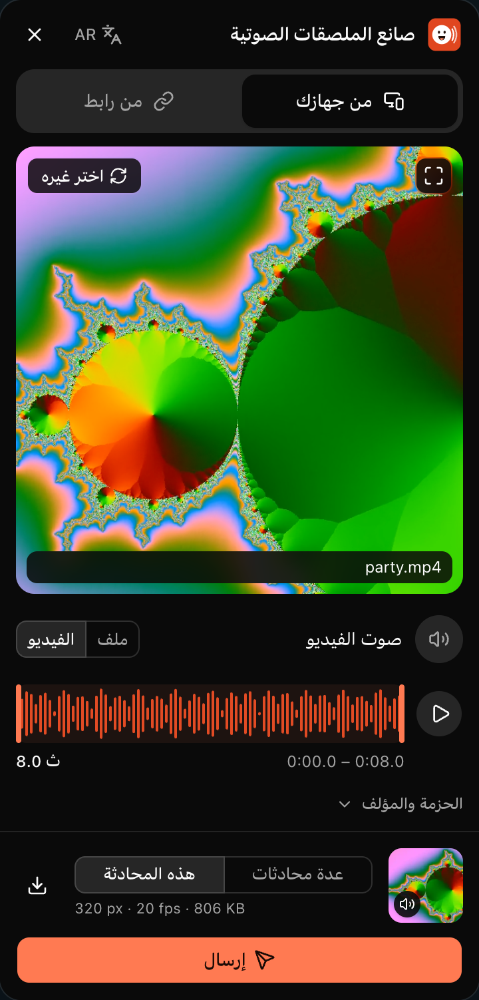

<p align="center">
  
</p>

<h1 align="center">Sound Sticker Maker</h1>

<p align="center"><strong>Make WhatsApp stickers that play sound, right inside WhatsApp Web.</strong><br />
A free, open-source Chrome extension that turns any video, GIF or photo plus a sound into a WhatsApp sound sticker.</p>

<p align="center">
  <a href="https://github.com/haythamasalama/sound-sticker-maker/releases/latest"><strong>⬇️ Download</strong></a> ·
  <a href="https://sound-sticker-maker.haythamasalama.me/">🌐 Website</a> ·
  <a href="https://sound-sticker-maker.haythamasalama.me/maker/">🎨 Try it online</a> ·
  <a href="https://sound-sticker-maker.haythamasalama.me/install/">📖 Install guide</a> ·
  <a href="CHANGELOG.md">📝 Changelog</a>
</p>

<p align="center">
  <a href="https://github.com/haythamasalama/sound-sticker-maker/actions/workflows/ci.yml"></a>
  <a href="https://github.com/haythamasalama/sound-sticker-maker/releases/latest"></a>
  <a href="LICENSE"></a>
  
</p>

<picture>
  <source media="(prefers-color-scheme: dark)" srcset="media/store-2@2x.png" />
  
</picture>

## ✨ What it does

- **Any picture, any sound.** A video with its own sound, a GIF with a song, or a photo with a voice note.
- **See the sticker before you make it.** A square preview loops the part you chose, exactly as it will look.
- **Trim on the waveform.** Drag the two handles, press play, keep 10 seconds or less.
- **Always under WhatsApp's 1 MB limit.** Size, frame rate and quality are picked for you.
- **Send to one chat or many.** Straight to the open chat, or to your own chat and then forward it.
- **From a link** (GitHub version): paste a YouTube or TikTok link and pick the seconds you want. Nothing opens in a new tab.
- **Six languages:** English, العربية, Español, Português, Bahasa Indonesia and हिन्दी, in light and dark.
- **Private.** Everything happens in your browser. No account, no servers, no tracking.

<table>
  <tr>
    <td></td>
    <td></td>
    <td></td>
  </tr>
</table>

## 🎯 How to make a WhatsApp sticker with sound

1. Install the extension (below) and open [web.whatsapp.com](https://web.whatsapp.com).
2. Click the round orange sticker button at the bottom right.
3. Choose a video, GIF or photo from your device, or paste a link.
4. Keep the video's sound or pick another one, then drag the handles to the part you want.
5. Click **Create sticker**, hear it, and click **Send**.

No editing skills needed. Don't have the extension yet? The [online maker](https://sound-sticker-maker.haythamasalama.me/maker/) makes the
same sticker files in your browser.

## 📦 Install

**From GitHub (includes YouTube and TikTok links)**

1. Download `sound-sticker-maker-<version>-github.zip` from the [latest release](https://github.com/haythamasalama/sound-sticker-maker/releases/latest) and unzip it.
2. Open `chrome://extensions`, turn on **Developer mode**, click **Load unpacked** and choose the unzipped folder.
3. Open [web.whatsapp.com](https://web.whatsapp.com) and click the orange sticker button.

Not sure how? The [install guide](https://sound-sticker-maker.haythamasalama.me/install/) has a button that copies the steps
for your AI assistant (ChatGPT, Claude, Gemini…), which then walks you through it.

Works in Chrome, Edge, Brave, Arc, Dia, Opera and other Chromium browsers (version 120 or later).

**Chrome Web Store:** coming soon. That version leaves out link import, because the store doesn't allow saving media
from other sites.

## ❓ FAQ

**Will my friends hear the sound?**
Yes, on WhatsApp versions that support sound stickers (rolling out since November 2026). Others see the moving sticker.

**Is it free?**
Yes. Free and open source under the MIT license.

**Are my videos uploaded anywhere?**
No. The sticker is made in your browser. It only goes to WhatsApp when you press Send.

**Does it work on my phone?**
The extension works on WhatsApp Web on a computer. The stickers you send play on phones too.

**Is it safe for my WhatsApp account?**
WhatsApp has no public way for other apps to send sound stickers, so the extension uses WhatsApp Web's own sticker
features, the same ones its built-in editor uses. WhatsApp can change them at any time; the extension warns you if that
happens.

## 🔒 Privacy

No account, no analytics, no servers of ours. See [PRIVACY.md](PRIVACY.md).

## 🛠️ Develop

```bash
pnpm install
pnpm check              # typecheck + lint + format check + tests
pnpm build              # builds apps/extension/dist/store and apps/extension/dist/github
pnpm site               # runs the website locally
node scripts/e2e.mjs    # loads the GitHub build into Chromium and walks through WhatsApp Web
node scripts/capture.mjs  # regenerates the images in media/
```

Load `apps/extension/dist/github` (or `dist/store`) with **Load unpacked**. How it fits together is in
[docs/ARCHITECTURE.md](docs/ARCHITECTURE.md); releasing and publishing are in [docs/RELEASING.md](docs/RELEASING.md) and
[docs/PUBLISHING.md](docs/PUBLISHING.md). Contributions are welcome: see [CONTRIBUTING.md](CONTRIBUTING.md).

## 📄 License

[MIT](LICENSE) © 2026 [Haytham A. Salama](https://haythamasalama.me/)
